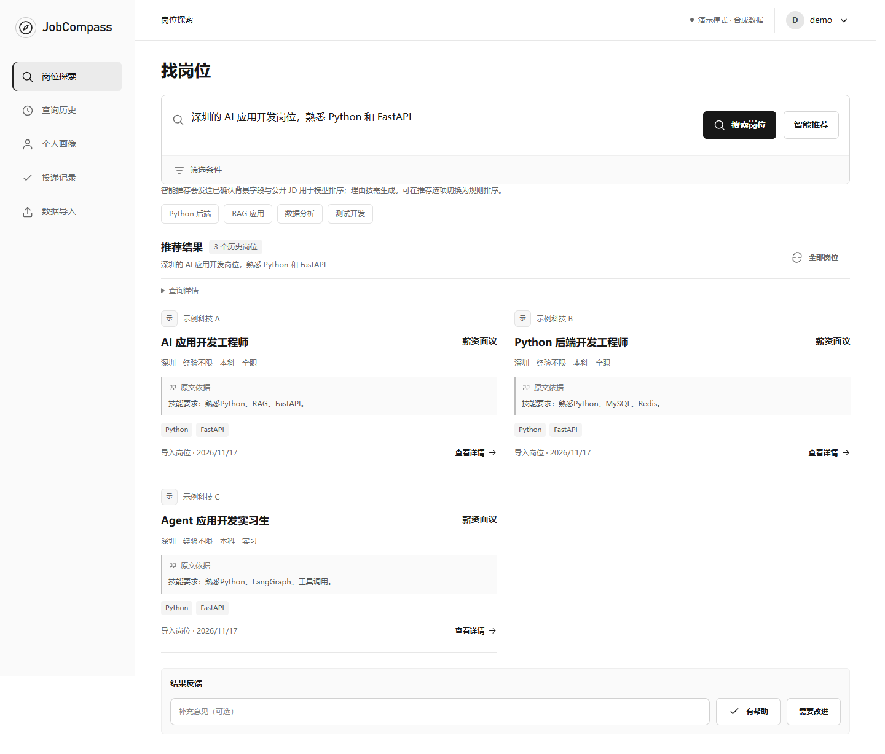
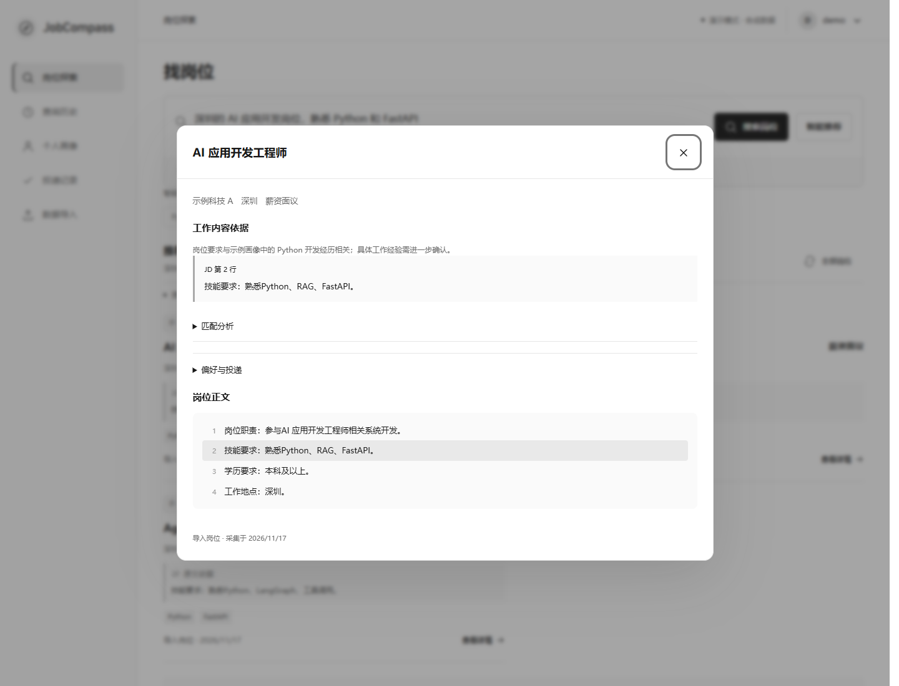
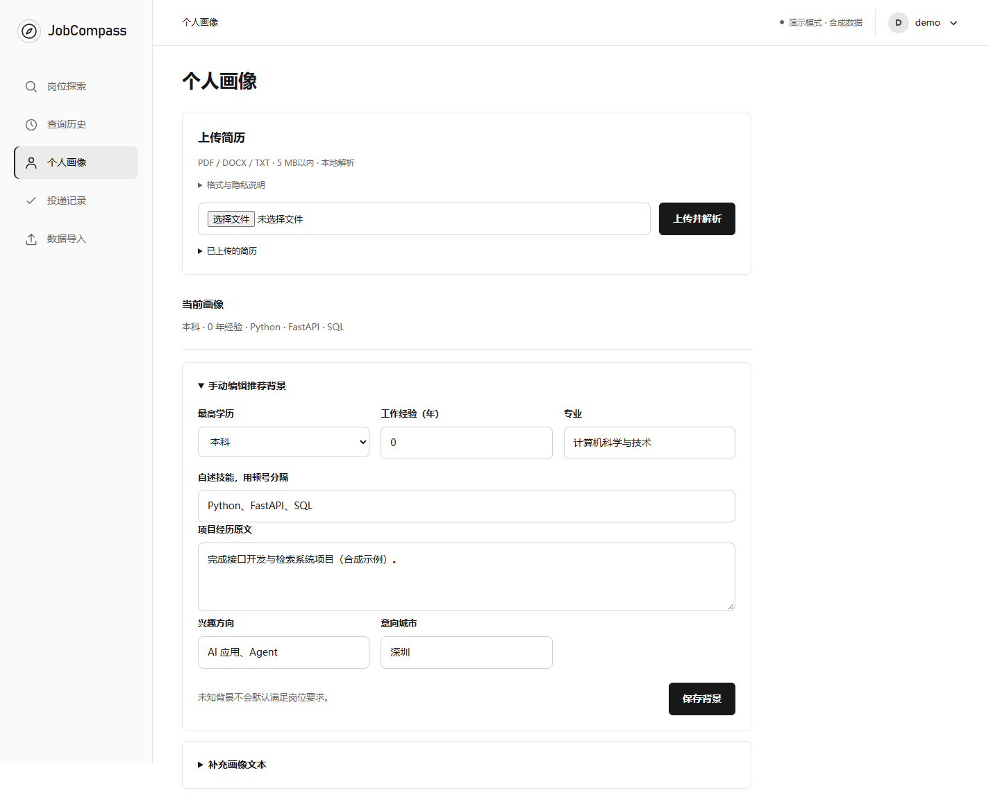
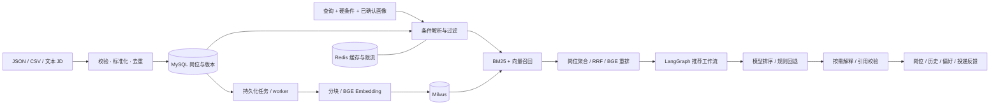

# JobCompass

**基于 RAG 的个性化岗位推荐系统**

将招聘 JD、个人画像与求职条件连接起来：检索岗位、比较匹配点、核对原文依据，并持续记录偏好与投递进展。

FastAPI · LangGraph · LangChain · BGE Embedding / Reranker · MySQL · Milvus · Redis

## 功能展示

### 岗位检索与个性化推荐

支持城市、学历、经验、招聘类型与技能条件；区分本轮硬条件与软偏好。BM25 检索完整岗位文档，向量检索 JD 文本块，聚合到岗位后进行 RRF 融合与 BGE 重排。



### 推荐理由与原文依据

推荐工作流结合已确认画像进行模型个性化排序；完整 JD 只排序，理由按需生成。引用需通过岗位身份、版本、行号与逐字原文检查；失败时显示规则排序或原文摘录降级，不补造岗位要求与用户经历。



### 个人画像与简历解析

支持文字型 PDF、DOCX、TXT 简历上传，本地提取字段、展示依据与冲突，用户确认后保存画像。结合技能、经历、兴趣与意向城市推荐岗位；支持喜欢、不喜欢及未投递、已投递、面试、Offer、拒绝等状态。



> 三张截图来自实际前端，使用合成账号、画像、岗位和固定接口响应，仅展示交互。不是线上实测或真实招聘数据；截图未调用外部模型，也不代表模型效果。

### 数据导入与后台处理

- JSON / CSV 文件及粘贴纯文本 JD；字段校验、标准化、去重、身份与内容版本管理。
- MySQL 持久化导入任务，独立 worker 执行导入与索引更新，支持幂等、租约、失败记录及重试。
- 岗位数据以 MySQL 为准；Milvus 为派生索引，返回前复核岗位有效状态和版本。
- 登录、账号资源归属校验、查询历史、结果反馈、投递记录、请求日志与限流。

## 架构



LangChain 封装工具与调用接口，LangGraph 管理有界状态工作流。当前采用预设节点与条件分支，不宣称开放式自主规划。

## 检索实验与工程验证

开发语料快照包含 **1,574 个岗位、2,068 个文本块**。真实语料及用户数据不随公开仓库发布，仓库提供独立的[合成导入样例](examples/jobs.json)。

| 对照 | 数据与统计范围 | 结论 |
| --- | --- | --- |
| 切块、查询改写、HyDE 等 8 方案 | 64 查询，开发 / 测试各 32，模型代理相关性标签 | 改写 / HyDE 未体现稳定的质量与时延综合收益；保留原查询、700 字符分块 |
| 排序与解释解耦 | 同 32 份合成画像及候选池，新增排序阶段平均耗时 | 完整 JD“排序＋解释”27.16 秒 → “只排序”9.18 秒，约减少 66%；测试 P@5 下降 3.75 个百分点，不称无损 |
| 工程回归 | pytest 固定模型响应；真实存储集成单独运行 | 覆盖条件、版本、权限、导入重试、模型协议、引用、服务降级与并发边界 |

这些结果来自固定实验快照，不是线上用户效果，也不将候选池 Recall 当成全语料 Recall。公开副本的最新检查结果见 [验证说明](docs/verification.md)。

## 运行

需要 Python 3.12、MySQL、Redis、启用认证的 Milvus，以及本地 BGE 模型。默认绑定本机，模型服务密钥由环境变量提供。

```bash
python -m venv .venv
# 激活虚拟环境后
pip install -e ".[dev]"
cp .env.example .env.local
```

Windows PowerShell 使用 `Copy-Item .env.example .env.local`。编辑本机配置，填入项目专用账号密码及 BGE 模型目录；不要提交配置和模型。开发数据库名为 `jobcompass_dev`，账号 `jc_rag_dev`；测试使用对应的 `test` 数据库与账号。Milvus 使用同名 dev/test 数据库及受限账号。Redis 使用 DB0 / DB1，另有项目环境键前缀。

```bash
python -m jobcompass migrate
python -m jobcompass serve
# 另一个终端
python -m jobcompass worker
```

打开 <http://127.0.0.1:8000>，注册账号，在“数据导入”上传 `examples/jobs.json`，等待任务完成后检索。空库可启动网页；向量化需要已配置的存储服务与 BGE 模型。

可选外部模型默认使用硅基流动的兼容 Chat Completions 接口。在本机设置 `SILI_API_KEY`；智能推荐会将允许字段的已确认背景与候选公开 JD 发送到配置的模型服务。简历原件和完整个人原文不直接用于外部模型请求。前端提供相关说明；按需理由与模型排序均有明确失败回退。

容器提供 API + worker，连接你已配置的三个存储服务；不是包含数据库的一键完整部署。模型目录挂载在 `compose.yaml` 中配置。生产发布需另行设置 HTTPS、可信代理、访问控制与备份。

## 自动化验证

```bash
ruff check src tests alembic
ruff format --check src tests alembic
pytest -m "not integration" -q
```

普通测试使用合成 fixtures 与固定模型响应，不需要真实招聘数据和模型调用。GitHub Actions 执行静态检查及同类测试。

集成测试需准备专用测试存储并设置 `JOBCOMPASS_INTEGRATION=1`，再执行 `pytest -m integration -q`；不要指向开发或生产库。fixtures 使用独立账号 / 主键 / 命名空间并清理自己的记录，测试不并行运行整个集成套件。

## 实现文档

- [系统架构与数据职责](docs/architecture.md)
- [检索并发与缓存边界](docs/search-concurrency.md)
- [Milvus独立部署、停机与恢复](docs/milvus-lifecycle.md)
- [导入格式、岗位身份与版本](docs/importing.md)
- [重复索引构建、校验与重试](docs/index-validation.md)
- [条件解析与未知字段](docs/conditions.md)
- [职责与引用证据校验](docs/evidence-sufficiency.md)
- [简历解析与画像确认](docs/resume-upload.md)

## 公开数据边界

公开仓库仅包含代码、合成示例、功能文档及脱敏截图。原始网页响应、招聘语料、简历原件、账号会话、查询历史、真实反馈、实验明细、本机配置及模型权重均未上传。爬虫入口用于来源适配，不绕过登录或验证；实际使用须遵守来源站点规则及数据使用要求。
