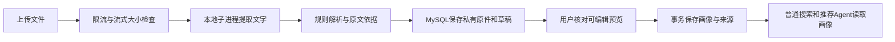

# 简历上传与个人画像

在网页“个人画像”顶部选择简历，点击“上传并解析”。查看提取原文、字段依据及可编辑预览，核对后点击“保存画像”。上传本身不会更新画像。确认后，普通搜索使用画像文本，推荐Agent读取结构化背景，无需在两个地方重复录入。

## 输入、输出与实现

输入是当前登录账号上传的文件。支持文字型PDF、DOCX和UTF-8 TXT；最多5MB，PDF最多15页，提取文本最多30000字符。每个账号最多保留20份原件，同账号相同内容和解析器版本重传复用记录。

输出是私有简历草稿：提取文本、建议字段、逐行原文依据、警告、与已有画像的差异，以及合并后的可编辑预览。确认后才在事务中同时更新`rag_users.profile.text`和`profile.background`，并保存原件SHA256、解析器版本及确认时间作为来源。



| 文件 | 职责 |
|---|---|
| `src/jobcompass/resume_extract.py` | PDF文字层、DOCX正文/表格段落、TXT解码与内容边界 |
| `src/jobcompass/resume_parser.py` | 简历分节、字段候选、依据与警告；版本resume-local.v1 |
| `src/jobcompass/resumes.py` | 有界提取子进程、账号归属、原件/草稿存储、确认事务及冲突检测 |
| `alembic/versions/0007_resumes.py` | 新增rag_resumes表、账号外键及内容唯一约束 |
| `src/jobcompass/web.py` | 上传、预览、确认、列表、下载和删除接口 |
| `web/resume.js` | 上传控件、预览编辑、依据展示与保存交互 |
| `tests/test_resumes.py` | 合成文件、解析规则、异常、真实MySQL/API归属与并发测试 |

## 当前解析规则

- 学历从教育段落或明确学历标签识别；在读/拟入学/预计等表述不直接计为已获得。候选学历仍需用户确认取得状态。
- 专业只识别明确“专业：”字段。学校、毕业时间等未作为新增结构化资格字段。
- 工作年限只读取唯一、明确的“工作经验：2年”或“2年工作经验”等表述。矛盾、范围、不足、否定、在校/项目日期不自动折算；缺失保持未知，应届用户可自行核对填写0。
- 技能从技能/项目/工作段落匹配固定词表，保守排除否定及计划学习表述；求职意向不当成已有能力。技能是自述关键词，不是能力认证。
- 项目经历保留该段原文，画像字段最多4000字符，截取会提示；完整提取正文仍保留。只在求职意向段落识别有限城市词表。兴趣方向由用户补充。
- 字段证据的行号属于**标准化后的提取文本**，不是PDF原页/原排版行号。PDF多栏、复杂表格可能打乱顺序，必须核对原件。当前是中文规则解析，未做真实多模板简历字段准确率评测。

当前不做OCR。图片型PDF没有可读文字层时明确拒绝，混合PDF的缺字页面会提示。加密、损坏、伪造格式、超限文件给出明确错误，不写成已成功解析。有关文字层与扫描件的提取边界可参见[pypdf官方说明](https://pypdf.readthedocs.io/en/6.21.1/user/extract-text.html)。

## 存储、隐私与一致性

原件以MySQL MEDIUMBLOB保存，草稿为JSON，全部按登录账号隔离；不放入公开raw、不写入运行日志或Git，不发送给外部模型。用户只可获取自己的原件与草稿。原件以附件下载；正文和证据由textContent渲染，文档中的指令只当文本，不执行宏或访问链接。

PDF/DOCX提取运行于独立本地子进程，15秒超时并结束子进程；每API进程最多同时2个提取。DOCX检查解压总量最多12MB、1000个条目，不解压到用户指定路径，不允许实体声明。文件尺寸/页数/正文长度与超时有界，未声称实现操作系统级内存硬限制。

上传是一次有界同步请求，不进入批量导入worker队列。提取失败返回错误、不创建草稿，可修正后重传；没有断点续跑或后台自动重试。文件仅在临时目录短暂提取，随后清理，原件和解析草稿以MySQL为准。

预览默认只补全空字段。与已有画像不一致的字段保留已有值并显示差异，用户可在预览中手动改成真实值。确认时锁当前用户及简历记录，检查基于画像内容的etag；若另一处已修改画像，返回409，需重新载入预览。相同确认重试幂等，不覆盖后续修改。现有画像其他字段、岗位偏好和投递状态保留。

删除简历会删除该账号的原件和解析稿，**已确认画像保持不变**，如需清除画像需自行编辑。已确认画像中的来源SHA/解析器版本记录保留；删除原件后不能再查看相应原件。

## 接口与验证命令

| 方法与路径 | 用途 |
|---|---|
| POST `/api/resumes` | 原始文件字节；X-Resume-Filename为URL编码文件名；返回草稿 |
| GET `/api/resumes` | 当前账号最近上传列表，最多20份 |
| GET `/api/resumes/{id}` | 预览，包含建议、原文、证据及当前画像etag |
| POST `/api/resumes/{id}/confirm` | background、profile_text、profile_etag，确认保存 |
| GET `/api/resumes/{id}/original` | 本人原件附件下载 |
| DELETE `/api/resumes/{id}` | 删除本人原件和草稿，不清除画像 |

上传接口按请求流检查实际字节数，也检查Content-Length；不依赖客户端文件大小声明。使用原始二进制请求体，前端直接提交File，不需要multipart依赖。请求流处理方式参考[Starlette官方文档](https://starlette.dev/requests/)。

```powershell
Set-Location /path/to/JobCompass
$jobPython='python'
& $jobPython -m jobcompass --env dev migrate
& $jobPython -m jobcompass --env test migrate
& $jobPython -m pytest tests/test_resumes.py -m 'not integration' -q
$env:JOBCOMPASS_INTEGRATION='1'
& $jobPython -m pytest -q --junitxml=artifacts/tests/resume-full.xml
Remove-Item Env:JOBCOMPASS_INTEGRATION
./scripts/compose.ps1 build
./scripts/compose.ps1 up
```

本轮Windows完整67项（10真实服务集成）通过；新增6项中2项连接真实MySQL/API，模块与全套连续重跑通过。Linux复验同套无服务57项通过，不能相加为124个独立测试。Ruff/format、JS语法和pip check通过。原测试前缀/临时账号/草稿定向清理，不清空共享数据库或Redis。

浏览器使用合成TXT与临时账号验证上传→预览→编辑→确认→刷新后重读→画像用于岗位推荐，未启用外部生成。PDF文字、DOCX表格通过合成文件自动化验证；不是用户真实简历兼容性或解析准确率评测。报告见`artifacts/tests/resume-*`及`artifacts/resume/20261103/verification.json`。

面试可说明：“实现了账号私有的简历导入与本地解析，保留原件、字段依据和待确认草稿；用户确认后用事务更新统一画像，通过内容版本检查避免覆盖并发修改。推荐Agent读取已确认背景，简历个人信息无需外发。”
